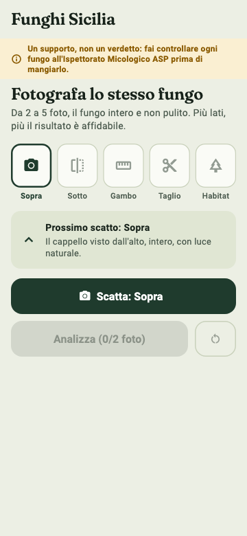
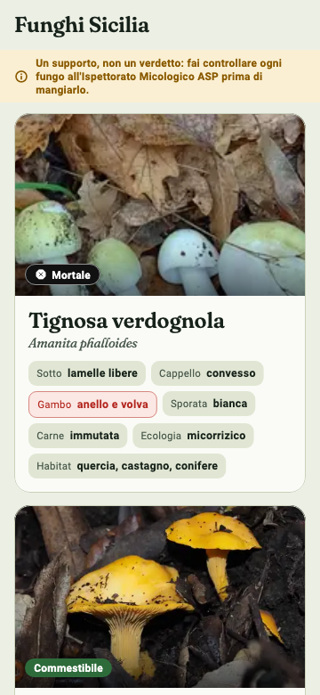
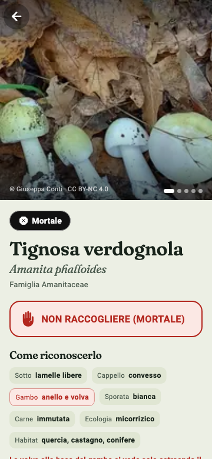
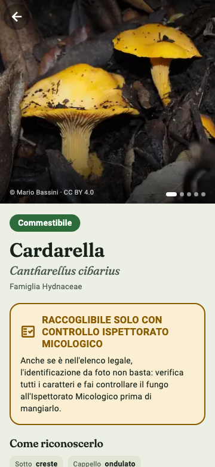
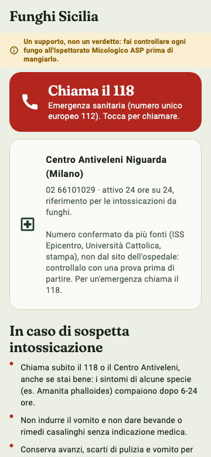

# 🍄 Funghi Sicilia

App Android **100% offline** per riconoscere i funghi della Sicilia da 3–5 foto e consultare schede di sicurezza: commestibilità secondo la normativa, sosia pericolosi, sintomi di avvelenamento, numeri di emergenza.

> ⚠️ **Avvertenza.** È un supporto informativo personale, **non** sostituisce il controllo dell'Ispettorato Micologico dell'ASP. Il riconoscimento automatico da foto sbaglia spesso (vedi [numeri onesti](#-quanto-è-affidabile-il-modello)). L'app non emette mai un verdetto "commestibile" dalla sola foto. In caso di dubbio: **non raccogliere, non mangiare**.

<p align="center">
  
  
  
  
  
</p>

## Indice

- [Cosa fa](#-cosa-fa)
- [Le 112 specie](#-le-112-specie)
- [Regole di sicurezza](#-regole-di-sicurezza)
- [Quanto è affidabile il modello](#-quanto-è-affidabile-il-modello)
- [Come è stato fatto](#-come-è-stato-fatto)
- [Struttura del repository](#-struttura-del-repository)
- [Compilare l'app](#-compilare-lapp)
- [Rigenerare dati e modello](#-rigenerare-dati-e-modello)
- [Fonti e licenze](#-fonti-e-licenze)
- [Limiti noti e cose da fare](#-limiti-noti-e-cose-da-fare)

## 📱 Cosa fa

L'app ha cinque schermate:

| Schermata | Descrizione |
|---|---|
| **Identifica** | Scatti o scegli 3–5 foto dello stesso fungo. Il modello TFLite gira sul telefono, media le probabilità delle foto e propone i candidati più probabili. Sotto una soglia di confidenza risponde **"non riconosciuto → NON RACCOGLIERE"**. Se la probabilità di una specie pericolosa supera il 5% mostra un avviso rosso anche se non è il primo candidato. |
| **Glossario** | Elenco delle 112 specie con ricerca full-text (SQLite FTS5), filtri per categoria di sicurezza e **caratteri distintivi visibili direttamente nelle card**. Ordinato per pericolosità. |
| **Scheda specie** | Nome scientifico, nomi italiani e siciliani, famiglia, 5 foto con autore e licenza, descrizione, habitat, commestibilità con le fonti, regole di raccolta, sindrome/latenza/sintomi per le tossiche, **sosia pericolosi con i caratteri discriminanti**, avvertenza. |
| **Diario** | Salva i ritrovamenti (foto, data, posizione GPS opzionale, note) in un database locale separato: aggiornare l'app non lo cancella. |
| **Emergenza** | Cosa fare in caso di sospetta intossicazione (latenza, conservare un campione, contatti, Ispettorato Micologico ASP). |

Tema "bosco" Material 3 con dark mode, font **Fraunces** incluso negli asset (nessuna richiesta di rete), icona a fungo rosso. Nessuna connessione internet necessaria: database, foto e modello sono dentro l'APK. Permessi richiesti: fotocamera e posizione (quest'ultima solo per il diario).

## 🧬 Le 112 specie

Solo le specie rilevanti per la sicurezza sono nell'app; le altre ~1.770 specie raccolte in fase di analisi restano fuori (sono in `data/species_db.sqlite` ma non vengono mostrate) e il modello le raggruppa in una classe **"altro"**.

| Categoria | N. specie |
|---|---:|
| Mortale | 7 |
| Tossico grave | 4 |
| Tossico | 19 |
| Vietato per legge | 1 |
| Commestibile condizionato (richiede cottura/trattamenti) | 6 |
| Commestibile in Italia ma non nell'elenco siciliano | 6 |
| **Commestibile** (elenco legale Sicilia) | 69 |

Ogni specie ha 5 foto (549 in totale) scelte per qualità e provenienza (priorità Sicilia → Italia → Europa/Mediterraneo).

## 🛡️ Regole di sicurezza

Queste regole sono scelte di progetto, non dettagli:

1. **Mai un verdetto "commestibile" dalla sola foto.** L'app propone candidati; la decisione resta all'umano e all'Ispettorato.
2. **La tossicità prevale sempre.** Se una specie è sia nell'elenco commestibili sia tossica/condizionata, vince la categoria più pericolosa.
3. **Riquadro rosso "NON RACCOGLIERE"** solo per le specie che non vanno raccolte (mortali, tossiche, vietate).
4. **Soglia di rifiuto:** sotto `0,675` di probabilità aggregata la risposta è "non riconosciuto → NON RACCOGLIERE".
5. **Allerta pericolose:** se P(specie pericolosa) ≥ 0,05 viene mostrato un avviso, anche se il primo candidato è commestibile.
6. **Fonti ufficiali per la commestibilità.** Wikipedia è usata solo per il testo descrittivo (morfologia, habitat), mai per dire se un fungo si mangia.
7. Ogni scheda riporta le fonti della classificazione e un'avvertenza finale.

## 📊 Quanto è affidabile il modello

Numeri misurati sul test set (991 foto singole, 776 di specie note e 215 della classe "altro"). Sono onesti, non ottimistici: **il modello non è abbastanza buono da fidarsi da solo**.

| Metrica | 1 foto | 3 foto |
|---|---:|---:|
| Top-1 (specie note) | 55% | 75% |
| Top-5 (specie note) | 81% | 95% |

Con la soglia di rifiuto `τ = 0,675` (1 foto):

| Metrica | Senza soglia | Con soglia |
|---|---:|---:|
| Foto accettate (specie note) | 100% | 27,6% |
| Top-1 sulle foto accettate | 55,0% | 88,8% |
| Pericolose scambiate per commestibili | 19,8% (53/268) | **0,75% (2/268)** |
| Mortali scambiati per commestibili | 14,3% | **0%** |
| Funghi "altro" rifiutati o riconosciuti come altro | 76,3% | 99,1% |

In pratica: la soglia rende molto raro l'errore pericoloso, al prezzo di rifiutare il ~72% delle foto. È il compromesso voluto.

Punti deboli noti: il richiamo sulle specie mortali varia molto (es. *Amanita phalloides* 88%, *A. verna* e *Lepiota brunneoincarnata* circa 25%), e nel training ci sono solo 153 foto siciliane. Il dettaglio per specie è in [`data/model/per_species.csv`](data/model/per_species.csv), le metriche complete in [`data/model/metrics.json`](data/model/metrics.json).

## 🔧 Come è stato fatto

Il progetto è nato come pipeline di dati in Python, poi un modello di visione, poi l'app Flutter.

### 1. Elenco specie e metadati
- Checklist dei **macrofunghi siciliani** (*Journal of Fungi*, 2022) parsata da XML/HTML (`04a_parse_checklist.py`) e abbinata alla tassonomia **GBIF** (`04b_match_gbif.py`) per ottenere `speciesKey` e nome accettato.
- Metadati delle osservazioni e delle foto da **GBIF** (`01_species_meta.py`), con priorità Sicilia > Italia > Europa e solo licenze CC0 / CC BY / CC BY-NC. Un campione di funghi non-target (`01b_photos_altro.py`) alimenta la classe "altro".

### 2. Elenco legale della commestibilità
- Testi ufficiali in [`data/fonti/`](data/fonti): **DPR 376/1995 Allegato I** e **D.P.Reg. Sicilia** (19/11/2007 e 4/8/2009, GURS). `04_edibili_legali.py` estrae i nomi e li abbina a GBIF: nessun nome entra se non compare nel testo ufficiale.
- Liste manuali verificate di specie tossiche (`tossiche.json`) e di **sosia pericolosi** con caratteri discriminanti (`sosia_pericolosi.json`); nomi siciliani in `nomi_siciliani.json`.
- Riferimenti: guida del Ministero della Salute / Ospedale Niguarda, ASP.

### 3. Database dell'app
- `03_build_db.py` costruisce il database completo (1.880 specie), `03a_traits.py` estrae i caratteri morfologici strutturati (habitat, cappello, imenio, ecc.) da fonti descrittive.
- `05_export_app_db.py` esporta solo le 112 specie rilevanti in `app_db.sqlite` con indice **FTS5**; `06_select_app_photos.py` sceglie 5 foto per specie; `07_sync_app_assets.py` copia tutto negli asset Flutter.
- Le foto vengono scaricate ridimensionate a **448 px, WebP q60**; gli originali non sono mai salvati.

### 4. Modello di riconoscimento (`pipeline/ml/`)
| Script | Cosa fa |
|---|---|
| `10_prepare.py` | Manifest e split train/val/test **per osservazione** (stratificato, nessuna fuga tra foto dello stesso ritrovamento); cache 224×224. 113 classi = 112 specie + "altro". Specie con meno di 5 foto: solo train, segnate "non valutabili". |
| `11_train.py` | Fine-tuning di **EfficientNet-B0** (ImageNet) in due fasi (prima solo la testa, poi tutta la rete con BatchNorm congelate), augmentation (flip, rotazione, zoom, traslazione, luminosità, contrasto), pesi di classe. |
| `12_eval_calibrate.py` | Valutazione su test, calibrazione soglie su validation, metriche di sicurezza. |
| `13_export_tflite.py` | Export TFLite e confronto delle varianti: float32 (16,6 MB), **float16 (8,4 MB, scelta)**, int8 dinamico (4,7 MB). Il float16 ha lo stesso top-1 del Keras (accordo 99,8%). |

### 5. App Flutter (`app/`)
Flutter/Dart (~3.300 righe), `sqflite` per il database, `tflite_flutter` per l'inferenza, `image_picker` per le foto, `geolocator` per le coordinate del diario, `url_launcher` per le chiamate di emergenza. La classificazione gira in locale e aggrega le probabilità con la media (`mean_prob`).

### Iterazioni di design
Dopo i primi test sul telefono sono state fatte scelte guidate dall'uso reale: categoria chiamata semplicemente **"Commestibile"**, caratteri distintivi subito visibili nelle card del glossario, e la dicitura "Ispettorato Micologico" tolta dalle schermate ordinarie (resta nella schermata Emergenza e nell'avvertenza finale delle schede).

## 📁 Struttura del repository

```
funghi-sicilia/
├── app/                      App Flutter
│   ├── lib/
│   │   ├── screens/          identify, glossary, species_detail, diary, emergency
│   │   ├── ml/               classifier + wrapper TFLite
│   │   ├── db/               accesso a SQLite
│   │   ├── models/           Species, caratteri distintivi
│   │   ├── services/         posizione
│   │   └── widgets/          componenti condivisi
│   ├── assets/               db, foto (WebP), modello TFLite, font, icona
│   └── android/
├── pipeline/                 script Python numerati nell'ordine di esecuzione
│   └── ml/                   preparazione, training, valutazione, export
└── data/
    ├── app_db.sqlite         database dell'app (112 specie)
    ├── species_db.sqlite     database completo (1.880 specie)
    ├── app_photos/           5 foto per specie con autore e licenza
    ├── fonti/                testi di legge (DPR 376/1995, GURS)
    ├── checklist_*.json      checklist siciliana e abbinamenti GBIF
    ├── model/                labels, soglie, metriche, model.tflite
    └── screenshots/          schermate di test
```

## 🏗️ Compilare l'app

Requisiti: Flutter (Dart ≥ 3.13), Android SDK.

```bash
cd app
flutter pub get
flutter build apk --release --split-per-abi
# APK in build/app/outputs/flutter-apk/
adb install -r build/app/outputs/flutter-apk/app-arm64-v8a-release.apk
```

Note:
- La release è firmata con la chiave **debug**: va bene per uso personale, non per il Play Store.
- Il diario è in un database separato: reinstallare "sopra" (`install -r`) lo conserva, disinstallare lo cancella.
- Alcune foto con licenza non ridistribuibile non sono incluse nel repository: l'app mostra un segnaposto al loro posto (vedi [Fonti e licenze](#-fonti-e-licenze)).

## ♻️ Rigenerare dati e modello

```bash
python3 -m venv .venv && source .venv/bin/activate
pip install requests pillow numpy      # pipeline dati

python pipeline/01_species_meta.py     # metadati GBIF
python pipeline/02_download_photos.py  # foto (WebP 448px)
python pipeline/03_build_db.py && python pipeline/03a_traits.py
python pipeline/05_export_app_db.py
python pipeline/06_select_app_photos.py && python pipeline/07_sync_app_assets.py
```

Per riaddestrare il modello serve **Python 3.12 + TensorFlow 2.19** (ambiente separato), le foto di training riscaricate con lo script 02 dai file `photos*.json`, poi `pipeline/ml/10…13`. Il checkpoint Keras (`model.keras`, 50 MB) non è nel repository; `model.tflite` sì.

## 📚 Fonti e licenze

**Commestibilità e normativa**
- DPR 376/1995, Allegato I; D.P.Reg. Sicilia 19/11/2007 e 4/8/2009 (GURS n. 40). *Eventuali modifiche successive al 2009 non sono state verificate.*
- Checklist macrofunghi siciliani, *Journal of Fungi* 2022.
- Guida Ministero della Salute / Ospedale Niguarda; ASP.
- Wikipedia (it/en): **solo** testo descrittivo, mai commestibilità.

**Dati e foto**
- Tassonomia e osservazioni: [GBIF](https://www.gbif.org) (iNaturalist, Naturgucker e altri contributori).
- Le foto restano di proprietà dei rispettivi autori, con le licenze originali (in maggioranza **CC BY-NC 4.0**, poi CC BY, CC BY-SA, CC0). Autore, licenza e link originale sono nella tabella `photos` di `app_db.sqlite` e visibili nell'app. Uso **non commerciale**; per riuso rispettare le singole licenze.
- Escluse dal repository (restano nel database con autore e licenza): 3 foto "all rights reserved", 26 foto CC BY-NC-ND (le ho ridimensionate e ricompresse, e la clausola ND vieta le opere derivate) e 7 foto Naturgucker con licenza non chiara ("Copyright by the creator"). Sono nel primo commit della cronologia.
- Font **Fraunces**: SIL Open Font License 1.1.
- Modello: EfficientNet-B0 pre-addestrato su ImageNet, poi fine-tuning.

**Codice**: [MIT](LICENSE). La licenza MIT copre solo il codice, non le foto né i testi di legge.

## 🚧 Limiti noti e cose da fare

- **Mai provata in bosco su larga scala**: servono errori reali per ritarare soglie e aggiungere foto.
- **Centro Antiveleni**: in Sicilia non ce n'è nessuno (secondo il Decreto 28/12/2020, Allegato XI; verificati solo 4 centri su 10, il testo integrale non è stato letto). L'app non riporta numeri di centri: indica il 118, che contatta il centro competente.
- 4 nomi dell'Allegato I senza corrispondenza GBIF: *Agaricus hortensis*, *Boletus badius*, *B. pinicola*, *B. rufus*. Due varietà con sinonimo dubbio nella checklist.
- *Psilocybe moravica* usa 10 foto di *P. serbica* (specie affine, solo in training con peso basso); *Volvariella esculenta* ha una sola foto.
- Circa 35 specie hanno schede senza dati strutturati completi (habitat, cappello, ecc.).
- Solo Android; nessuna build per iOS.
